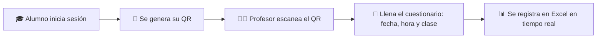

# 📱 Asistencia QR

### App móvil para tomar asistencia con códigos QR, con vista de alumno y de profesor

 

 

---

## ✨ ¿Qué es?

Una aplicación Android desarrollada en **Thunkable** que digitaliza el pase de lista. Tiene **dos vistas en la misma app**, una para alumnos y otra para profesores, cada una con su propia cuenta. El alumno muestra un QR único y el profesor lo escanea para registrar la asistencia, que queda guardada **en tiempo real** en una hoja de Excel.

## 🎯 Características

| | Característica |
|:---:|:---|
| 👥 | **Dos vistas** en una sola app: alumno y profesor |
| 🔐 | **Cuentas de usuario** para cada rol |
| 🧾 | **QR generado automáticamente** para el alumno, con día, fecha y datos de la sesión |
| 📷 | **Escáner de QR** con la cámara del teléfono del profesor |
| 📝 | **Cuestionario de Forms** para verificar la fecha, la hora y la clase |
| 📊 | **Registro en tiempo real** en una hoja de Excel |

## 🔄 Cómo funciona

### 🎓 Vista del alumno
1. Inicia sesión con su cuenta.
2. La app genera automáticamente su QR con el día, la fecha y los datos de la sesión.
3. Le muestra el QR al profesor desde su teléfono.

### 👨‍🏫 Vista del profesor
1. Inicia sesión con su cuenta.
2. Abre la cámara y escanea el QR en el teléfono del alumno.
3. Llena el cuestionario para confirmar la fecha, la hora y la clase.
4. La asistencia se guarda al instante en la hoja de Excel.

## 📸 Capturas

| Vista del alumno | Vista del profesor |
|:---:|:---:|
|  |  |

## 📥 Instalación

1. Entra a [**Releases**](https://github.com/AreR9/app-asistencia-qr/releases/latest).
2. Descarga el **APK** en tu celular Android.
3. Permite la instalación de orígenes desconocidos si el sistema lo pide.
4. Abre el archivo e instala la app.

## 🛠️ Tecnologías

- **Thunkable**: desarrollo de la app con bloques
- **Generación y lectura de códigos QR**
- **Formulario (Forms)** para la verificación de la sesión
- **Excel** como registro de asistencia en tiempo real

## 📄 Documentación

- [Documentación final](docs/Documentación%20Final%20app%20Asistencia.pdf)
- [Proyecto App Asistencia](docs/Proyecto%20App_Asistencia%206.pdf)

---

### 👩‍💻 Desarrollado por **Areli Reynoso**

